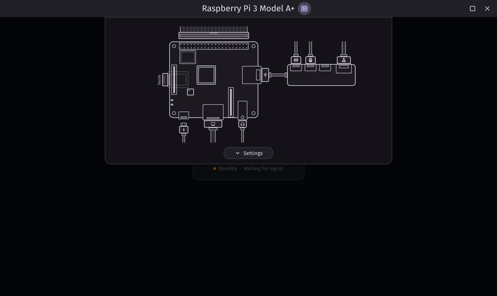

# FauxPi

FauxPi is a Raspberry Pi hardware simulator application.

[](https://snapcraft.io/fauxpi)



## Features

- **Supported Boards**:
  - Raspberry Pi 1 A+ and B+
  - Raspberry Pi 3 A+ and B+
  - Raspberry Pi Zero, Zero W, and Zero 2 W
- **VideoCore IV Graphics**: Efficiently simulates accelerated video.
- **Interactive Board Sheet**: Connect and disconnect connectors like a read piece of hardware.
- **Storage**: Manager multiple SD card images.
- **Networking & Audio**: Ethernet, Wi-Fi and audio supported.

## Running

Launch FauxPi by running the included script. No dependencies required.

```sh
./scripts/zig build run
```

## Benchmarking

`zig build bench` boots a bare-metal test suite for the Raspberry Pi Zero in FauxPi, headless, a
test a boot: the CPU, the DMA engine, the V3D 3D engine and the HVS display scaler. It reports each
test's time and where FauxPi spent it, as JSON (on stdout) and a table (on stderr). `--linux` runs
the same GPU scenes through a minimal Raspberry Pi kernel (built once, with
`arm-linux-gnueabihf-gcc`) and its vc4 driver, shown with KMS page flips, with the boot, system
calls and page faults timed too.

```sh
./scripts/zig build bench                       # every bare-metal test
./scripts/zig build bench -- --v3d all          # ...with V3D on the GPU, half on it, and on the CPU
./scripts/zig build bench -- --linux            # the Linux tests
./scripts/zig build bench -- --list             # what each test measures
./scripts/zig build bench -- --help
```

FauxPi's own `--profile <file>` writes the same report for any run.
