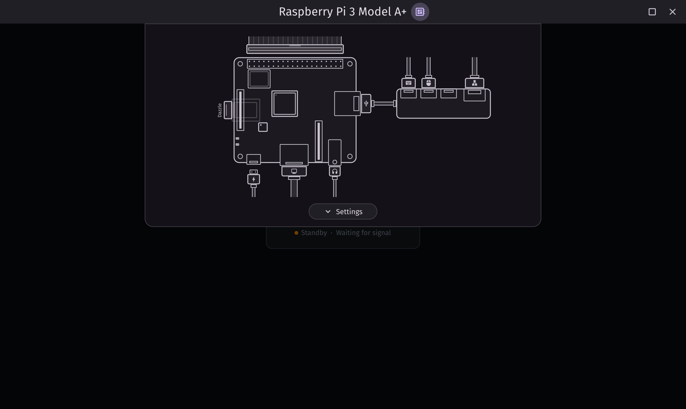

# FauxPi

FauxPi is a Raspberry Pi hardware simulator application.



## Features

- **Supported Boards**:
  - Raspberry Pi 1 A+ and B+
  - Raspberry Pi 3 A+ and B+
  - Raspberry Pi Zero, Zero W, and Zero 2 W
- **VideoCore IV Graphics**: Efficiently simulates accelerated video.
- **Interactive Board Sheet**: Connect and disconnect connectors like a read piece of hardware.
- **Storage**: Manager multiple SD card images.
- **Networking & Audio**: Ethernet, Wi-Fi and audio supported.

## Building and Running

Build and launch FauxPi using the included Zig wrapper script:

```sh
./scripts/zig build run
```
